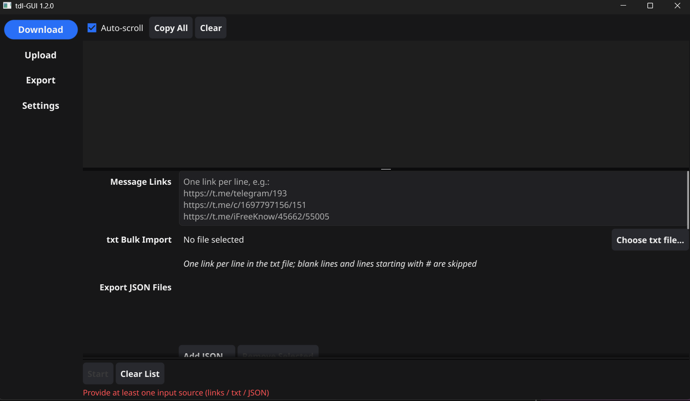
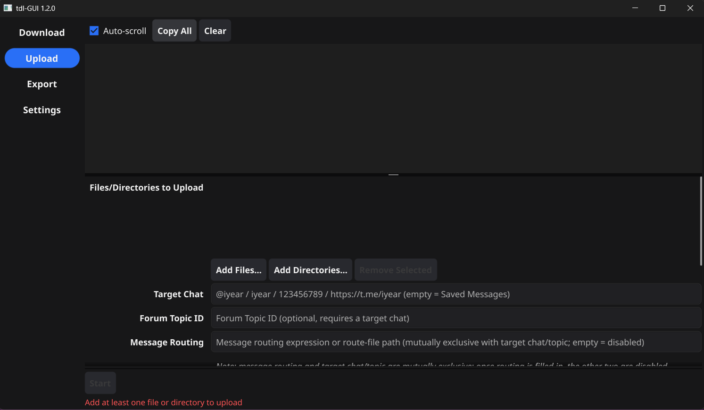
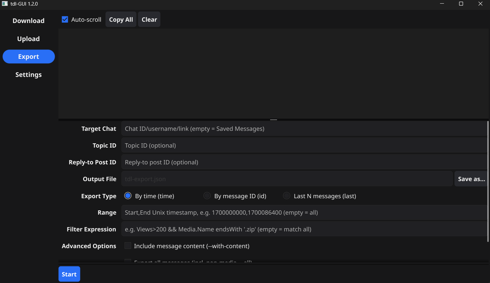

# tdl-GUI

[简体中文](README.md) | [English](README_Eng.md)

A **Windows desktop graphical front-end** for [tdl](https://github.com/iyear/tdl) (Telegram Downloader).

This project reimplements none of tdl's functionality. It does exactly two things: **assembling the form fields into a tdl command**, and **running `tdl.exe` while echoing its output in real time**.

> UI screenshots:
> 
> 
> 

> **Platform limitation**: Windows only. The program relies on Windows-specific features such as `CREATE_NO_WINDOW`, `CREATE_NEW_CONSOLE` and `taskkill`, so other platforms are not supported for now.

## Table of Contents

- [tdl-GUI](#tdl-gui)
  - [Table of Contents](#table-of-contents)
  - [Overview](#overview)
  - [Quick Start](#quick-start)
    - [1. Prepare tdl.exe](#1-prepare-tdlexe)
    - [2. Launch tdl-GUI](#2-launch-tdl-gui)
    - [3. Configure tdl.exe](#3-configure-tdlexe)
    - [4. Log In to Your Account](#4-log-in-to-your-account)
    - [5. Download Files](#5-download-files)
    - [6. Upload Files](#6-upload-files)
    - [7. Export Messages](#7-export-messages)
    - [8. Running and Aborting](#8-running-and-aborting)
  - [Based on the tdl Project](#based-on-the-tdl-project)
  - [Language and Technology Stack](#language-and-technology-stack)
  - [Application Architecture](#application-architecture)
  - [Features at a Glance](#features-at-a-glance)
  - [Building from Source](#building-from-source)
  - [FAQ](#faq)
  - [Disclaimer and Acknowledgements](#disclaimer-and-acknowledgements)

## Overview

- **No need to memorize command lines**: downloads, uploads, message exports, login and global parameters are all configured through the GUI.
- **Real-time log**: a black terminal-style log pane that streams tdl output line by line; supports in-place refresh of `\r` progress lines, correct alignment of CJK / full-width characters, and red highlighting for errors (buffer capped at 5000 lines).
- **Controllable tasks**: one-click **[Abort]** (kills the whole process tree), global controls locked while a task is running, confirmation before closing the window during a task, and a 5-second watchdog warning on abort.
- **Input validation**: when input is invalid, the **[Start]** button is disabled and the reason is shown in red; the UI and the final command share exactly the same validation logic.
- **Persisted configuration**: global parameters and form tuning options are saved automatically; the target scope of unfinished tasks (links, file lists, etc.) is deliberately not restored, so nothing is run by accident on the next launch.
- **Command echo**: the full command is printed to the log pane before execution, with the login password masked as `***`.

## Quick Start

**Runtime requirements** :

- **Windows 10 / Windows Server 2016 or later (64-bit)**
- **A graphics driver supporting OpenGL 2.0 or higher**

### 1. Prepare tdl.exe

Download the Windows build from <https://github.com/iyear/tdl/releases> and extract it to any directory (version 0.20.4, or something close to it, is recommended).

### 2. Launch tdl-GUI

Double-click `tdl-gui.exe`. On first launch the app automatically switches to the **[Settings]** page and prompts you to choose the `tdl.exe` path.

### 3. Configure tdl.exe

Go to the **[Settings]** page → Global Parameters → click Browse to select the `tdl.exe` path → click `[Test]`. If the tdl version information appears in the log pane, the setup works.

### 4. Log In to Your Account

**[Settings]** page → Login Management → click `[Login]`; the program opens a new terminal window:

- In that window, use the arrow keys to select the account to log in with;
- Only the Telegram desktop client method is supported, and the client must come from the official Telegram website (not the app-store version);
- After logging in, enter the namespace you used into **[Current Namespace]** on the settings page.

**Multiple accounts**: use a different namespace for each account (e.g. `acc1`, `acc2`); each namespace corresponds to an independent account/session.

### 5. Download Files

**[Download]** page: paste message links (one per line, both `https://t.me/...` and `tg://` are supported), or bulk-import from a txt / JSON file → set the download directory, thread count and concurrency → choose the resume strategy → click **[Start]**.

Notes:

- Choose **explicitly** between "resume" and "restart" for the resume strategy: in the default mode tdl asks interactively when it detects an unfinished task, and a GUI child process cannot provide input.
- Enabling "rewrite extensions" rewrites extensions based on the file-header MIME type (for example, `.apk` may become `.zip`).
- For large downloads, enabling Takeout mode is recommended to reduce the chance of hitting a flood wait.
- txt import rules: one link per line; blank lines and lines starting with `#` are skipped.

### 6. Upload Files

**[Upload]** page: add files/directories → fill in the target chat (`-c`), and the topic ID as well if you want to post to a forum topic → optionally captions and extension filters → click **[Start]**.

Notes: enabling "delete local files after upload" (`--rm`) is irreversible and requires a second confirmation before execution; "message routing" and "target chat/topic" are mutually exclusive.

### 7. Export Messages

**[Export]** page: fill in the target chat → choose the export type (by time / by message ID / latest N messages) and range → choose the output file → click **[Start]**.

### 8. Running and Aborting

- While a task is running, the log pane above streams the output in real time; clicking the red **[Abort]** button force-stops the task (killing the whole process tree).
- Closing the window while a task is running asks for confirmation; once confirmed, the task is aborted automatically and the app exits.

## Based on the tdl Project

- All actual capabilities of this project are provided by [tdl](https://github.com/iyear/tdl); the GUI only assembles arguments and runs the process, and **contains no Telegram protocol implementation whatsoever**.
- **You must provide `tdl.exe` yourself** (this project does not bundle it): download the Windows build from [tdl Releases](https://github.com/iyear/tdl/releases) and specify its path on the GUI settings page.
- Command arguments and default values are aligned with **tdl 0.20.4** (such as `--reconnect-timeout 5m`, `--pool 8`, `--delay 0s`), and are appended automatically by this project when a task runs.
- tdl subcommands currently covered: `login`, `dl`, `up`, `chat export`, `version`.

> This project is a third-party front-end with no affiliation to the tdl maintainers; see the [Disclaimer](#disclaimer-and-acknowledgements) at the end for details.

## Language and Technology Stack

| Item | Details |
| --- | --- |
| Language | Go 1.27.1 |
| GUI framework | [Fyne](https://fyne.io/) v2.8.1 (native OpenGL window, not a WebView) |
| Other dependencies | [mattn/go-runewidth](https://github.com/mattn/go-runewidth) (wide-character column width calculation in the log pane) |
| Configuration storage | Fyne Preferences; on Windows usually `%AppData%\fyne\tdl-gui\preferences.json` |
| Supported platform | Windows only |

## Application Architecture

```
tdl-GUI/
├── main.go                      Entry point: create the Fyne App, build the window, enter the event loop
├── internal/
│   ├── ui/                      UI layer (the only layer that depends on Fyne)
│   │   ├── app.go               Main window, left navigation, log/page split, first-launch guide, close interception
│   │   ├── task.go              Task state machine: start/abort/exit code, global control lock, abort watchdog
│   │   ├── logview.go           Terminal-style log pane: streaming output, progress-line overwrite, wide-char alignment, copy/clear
│   │   ├── page_download.go     Download page
│   │   ├── page_upload.go       Upload page
│   │   ├── page_export.go       Message export page
│   │   └── page_settings.go     Settings page (UI language + global parameters + login management)
│   ├── cmdgen/                  Form structs → tdl command-line arguments, including all input validation (zero GUI dependencies)
│   ├── runner/                  Child process lifecycle: start, stdout/stderr parsing, ANSI stripping, abort process tree
│   ├── store/                   Fyne Preferences wrapper, key naming convention `<page>.<field>`
│   ├── i18n/                    Localization (the Chinese text is the key; locales/*.json provides translations)
│   └── txtload/                 txt link-list parsing (tdl's native `-f` accepts JSON only)
└── go.mod
```

Layering and call relationships:

```
ui ──┬─► cmdgen   build command + validate
     ├─► runner   start process / parse output stream / abort
     ├─► store    read and write configuration
     └─► txtload  parse txt link files
```

Key design decisions:

- **Single source of validation**: the enabled state of UI controls and the final executed command are produced by the same build function in `cmdgen`, avoiding the mismatch where the UI allows something the command rejects.
- **Process-level integration**: tdl's source is neither modified nor wrapped; only `tdl.exe` is run. stdout and stderr are merged and parsed, treating `\r` as a progress refresh and `\n` as a complete line.
- **Abort means killing the tree**: the whole process tree is ended with `taskkill /T /F`, falling back to a forced kill on failure, with a 5-second watchdog warning.
- **Special handling for login**: `tdl login` needs interactive input, so the program runs it in a real terminal window via the Windows `CreateProcess` + `CREATE_NEW_CONSOLE`.
- **Input length protection**: a single download is capped at 800 links to avoid hitting the Windows command-line length limit (about 32K).

## Features at a Glance

| Module | Capabilities |
| --- | --- |
| Download `dl` | Multiple links / txt bulk import / JSON file import; download directory, threads, concurrency; resume strategy (default / resume / restart); extension whitelist and blacklist; filename template; album grouping, skip same-name files, Takeout, HTTP serve mode |
| Upload `up` | Bulk upload of files or directories; target chat and forum topic; message routing; captions; extension filtering; delete local files after upload (with a second confirmation); photo mode |
| Export `chat export` | Three export types (by time / by message ID / latest N messages) with ranges; filter expressions; attached content / export everything / raw structure |
| Login `login` | Desktop-client login (choose the account with arrow keys in a new terminal window); multiple accounts managed through namespaces (`-n`), where each namespace is an independent account |
| Settings | UI language (follow system / Simplified Chinese / English, **takes effect after restart**), tdl.exe path, current namespace, proxy, NTP server, reconnect timeout, DC connection pool, delay between tasks, storage, debug mode, disable progress telemetry; the `[Test]` button runs `tdl version` to verify availability |

## Building from Source

Requirements: Windows + Go 1.27.1 or later.

```powershell
go build -ldflags "-H windowsgui -s -w -X main.version=x.y.z" -o tdl-gui.exe .
```

Flag reference:

- `-H windowsgui`: start in the GUI subsystem so no extra console window appears;
- `-s -w`: drop the symbol table and debug information to reduce the executable size;
- `-X main.version=x.y.z`: inject the version number, shown in the window title `tdl-GUI <version>`; see `main.go`--version for the actual version number.

Run the tests (some tests really start system commands, so they only work on Windows):

```powershell
go test ./...
```

> Note: `internal/runner/console_windows.go` depends on the Windows API and **cannot be compiled on other platforms**.

## FAQ

**Q: Do I need to install tdl separately?**
Yes. This project does not include tdl itself; download `tdl.exe` yourself and specify its path on the settings page.

**Q: Why are there no "account list / switch default account / logout" buttons?**
The current tdl version (0.20.4) provides no such commands, so this page offers no such buttons. Use namespaces to switch between multiple accounts.

**Q: Will tdl remember the global parameters from the settings page?**
No. Global parameters such as proxy, NTP and connection pool are appended automatically by this application on every task run; they are not written into tdl's own configuration.

**Q: Where is the configuration stored?**
It is managed by Fyne Preferences, usually `%AppData%\fyne\tdl-gui\preferences.json` on Windows. Note that login passwords are stored there in plain text, so keep your local environment secure.

**Q: Does it restore the task left unfinished last time?**
No. Task target-scope inputs (links, txt/JSON paths, upload paths, chats, output files, etc.) are not persisted and are cleared at startup; all other tuning options are restored automatically.

**Q: Can it forward messages / use other tdl subcommands?**
Not for now. Only `login`, `dl`, `up`, `chat export` and `version` are covered.

## Disclaimer and Acknowledgements

This project is a **third-party graphical front-end** for [tdl](https://github.com/iyear/tdl). It is not an official project and has no affiliation with the tdl authors or with Telegram. It implements no Telegram protocol and bundles no tdl binary; all network behavior and data processing are performed by tdl. Any consequences of using this software are borne solely by the user, and you must comply with Telegram's Terms of Service and your local laws and regulations.

Acknowledgements:

- [iyear/tdl](https://github.com/iyear/tdl): the source of all underlying capabilities of this project;
- [Fyne](https://fyne.io/): the Go cross-platform GUI framework;
- [mattn/go-runewidth](https://github.com/mattn/go-runewidth): character width calculation in the log pane.
